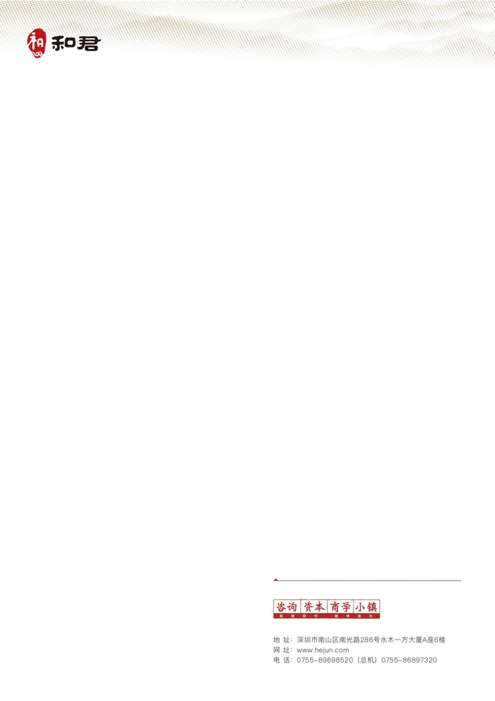

# 和君设计语言 · Hejun Design Language

适用于 Codex 的和君品牌设计 Skill。基于用户提供的和君红 V2026 官方 PPT 模板、集团简介，以及事业部和研究中心历史材料提炼。

支持 PPT、Word、PDF、HTML 的制作和排版改版。默认采用 **和君红 V2026**，历史青蓝风格按需求延续。包含官方空白 PPT、原始 Logo、主题色 token、推导 Word/HTML starter、格式指南及辅助脚本。

> 本项目是从材料提炼的工作规范，并非和君品牌部门发布的完整 VI 手册。Word/PDF 使用用户指定的深圳信纸原件；HTML 和推荐正文排版等扩展规则注明为推导值。现已随排版工具配套提供华为官方原版 HarmonyOS Sans SC 字体，保留完整许可与来源校验。

## 在 Codex 中安装

向 Codex 发送：

```text
请用 $skill-installer 安装这个 Skill：
https://github.com/ZiqiCode/Hejun-Design-Language/tree/main/.agents/skills/hejun-design-language
```

如果使用安装器命令：

```sh
python <skill-installer目录>/scripts/install-skill-from-github.py --repo ZiqiCode/Hejun-Design-Language --path .agents/skills/hejun-design-language
```

安装后在下一轮对话使用；若客户端尚未刷新，可重新启动 Codex。也可在 Codex 打开克隆后的仓库，使用仓库内 `.agents/skills/`。

## 使用示例

```text
用 $hejun-design-language 把这份项目资料制作成一份 12 页中文客户提案 PPT，使用和君红，保留可编辑图表。
```

```text
用 $hejun-design-language 把这份 Word 研究报告重新排版，并导出 PDF，保留原文事实和来源。
```

```text
用 $hejun-design-language 根据这份需求制作响应式 HTML，交付离线单文件和可编辑源文件夹。
```

```text
用 $hejun-design-language 延续这份旧稿的青蓝风格，改善排版，验证后替换到原位置。
```

“替换原位置”只在具体任务要求时执行。Skill 不会自动上传附件、联系客户或发布网页。

## 所有 Word/PDF 使用深圳信纸

根据用户要求，**每一份 Word 和 PDF 的每一页都使用深圳信纸**，包括封面、续页、目录和附录。PPT/HTML 本体维持原设计，导出 PDF 时也要使用信纸。

- [信纸原件](.agents/skills/hejun-design-language/assets/letterhead/hejun-shenzhen-original.docx)：原文件字节不变。
- [PDF 信纸底版](.agents/skills/hejun-design-language/assets/letterhead/hejun-shenzhen-blank.pdf)：原信纸经 Word 导出。
- [使用与适配规则](.agents/skills/hejun-design-language/references/letterhead-workflow.md)：保留页眉纹理、Logo、深圳页脚原图；不重复添加 Logo。

```sh
python .agents/skills/hejun-design-language/scripts/init_word.py /new/report.docx --title "项目名称"
python .agents/skills/hejun-design-language/scripts/apply_pdf_letterhead.py input.pdf /new/report.pdf
```

第二条用于尚未带信纸的普通静态 PDF，生成 A4 页并将原内容等比放入安全正文区，保留矢量文字；长文建议先重排。已有信纸的 Word 导出 PDF 不再叠加。脚本拒绝有链接、批注、表单、附件或签名的 PDF，避免静默丢失功能。



## 不安装字体如何使用

仓库配套包含 HarmonyOS Sans SC Light、Regular、Medium、Bold 四个原版 TTF，及原始许可、可读许可和来源 SHA-256。没有进行字体格式转换或字形子集化。

- **HTML**：starter 通过 `@font-face` 加载配套字体。初始化脚本自动复制字体和许可；离线打包器将完整 TTF 嵌入单文件，读者不需要安装字体。常用三种字重会增加单文件约 33 MB（Base64 后），需要 Light 时再添加它。
- **PDF**：制作工具从字体文件加载，并在导出时完整嵌入所用字体；验收时检查 PDF 的真实字体与嵌入状态。仅设置字体名称不足以证明嵌入。
- **Word / PPT**：制作环境必须支持加载该字体。可用任务级字体目录或进程内加载时优先采用；不能把仓库中存在 TTF 等同于 Office 已加载。交付时使用支持的 Office/文档引擎完整嵌入字体，并检查文件包。接收端是否支持嵌入字体仍取决于具体软件。不要无提示改用微软雅黑。

不自动安装到系统，也不承诺所有 Word/PPT 阅读器都能免安装编辑。Word starter 已采用深圳信纸并完整嵌入鸿蒙 Regular/Bold，PDF 参考使用同一信纸独立排版；使用时按 [字体工作流](.agents/skills/hejun-design-language/references/font-workflow.md) 重新应用并验证。

可在通用 prompt 中加入：

```text
请先加载仓库 assets/fonts 中的原版 HarmonyOS Sans SC 字体。HTML 使用 @font-face，PDF 完整嵌入，Word/PPT 使用支持字体加载与完整嵌入的制作工具。不要仅因系统未安装就改用微软雅黑；如工具确实不支持，明确说明限制与替代方案。保留字体许可，不修改或子集化字体文件。
```

## 内容与证据

- [Skill 入口](.agents/skills/hejun-design-language/SKILL.md)
- [设计规范](.agents/skills/hejun-design-language/references/design-system.md)
- [来源与证据](.agents/skills/hejun-design-language/references/source-evidence.md)
- [原始主题色和推荐版式](.agents/skills/hejun-design-language/assets/tokens.json)
- [官方五页 PPT 模板](.agents/skills/hejun-design-language/assets/templates/hejun-official-red-v2026.pptx)
- [Word starter](.agents/skills/hejun-design-language/assets/templates/hejun-starter.docx)
- [HTML starter](.agents/skills/hejun-design-language/assets/templates/hejun-starter.html)
- [验证记录](VALIDATION.md)

已对 31 份 PPTX/PDF（共 1,147 个页/幻灯片，含同名与版本重复）做结构清点，并抽样观察历史版式；官方五页模板做全页渲染检查。仓库不收录历史业务正文、客户案例或联系名单。完整证据边界见来源文档。


## 权利说明

和君品牌名称、Logo、背景和原始模板的权利归各自权利人。本项目不授予第三方使用、转售或再许可这些品牌资产的权利。本工具使用 HarmonyOS Sans Fonts。Copyright 2021 Huawei Device Co., Ltd. 字体以官方许可随本工具配套分发，保持原文件不变，不作独立字体下载服务或单独转售；详见 [字体许可](.agents/skills/hejun-design-language/assets/fonts/LICENSE-readable.txt)。

结构参考 [DeepStone Design Language](https://github.com/lajayliu2-ops/deepstone-design-language)，和君规范、素材映射与辅助代码重新编写。此仓库未设置覆盖品牌素材的通用开源许可。
